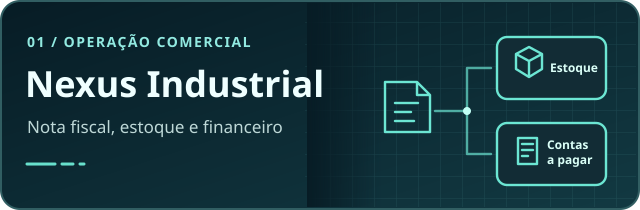
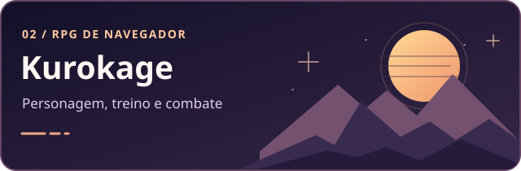

# Lucas Larrat

Desenvolvo aplicações web com foco em regras de negócio, integrações e experiência de uso. Gosto de trabalhar em problemas em que uma ação precisa manter várias partes do sistema em sincronia: da entrada de uma nota fiscal ao estoque e ao financeiro, ou de um combate ao progresso de um personagem.

[LinkedIn](https://linkedin.com/in/lucas-larrat) · [E-mail](mailto:lucaslarrat@gmail.com)

## Projetos em destaque

### Nexus Industrial · Sistema Comercial

**Problema:** fazer o estoque e o financeiro acompanharem a operação da loja, sem depender de lançamentos duplicados.

**Decisão:** integrar a importação do XML da NF-e ao movimento de estoque e à criação do lançamento em contas a pagar. No fluxo de venda, o cancelamento reverte estoque e recebíveis na mesma transação.

[Repositório](https://github.com/larrat/sistema_comercial) · [Arquitetura dos fluxos de ERP](https://github.com/larrat/sistema_comercial/blob/main/docs/status/FASE_ERP_RELATORIO.md)

### Kurokage · GAME_NT

**Problema:** manter o progresso de um RPG de navegador consistente quando personagens treinam, lutam e recebem recompensas.

**Decisão:** validar regras importantes de combate e economia no servidor e separar, no acompanhamento do projeto, o que foi implementado do que foi homologado no jogo. Raids verificadas e reset VIP ficam desabilitados até a validação em homologação, conforme o README do projeto.

[Repositório](https://github.com/larrat/game_nt) · [Estado e critérios de homologação](https://github.com/larrat/game_nt/blob/master/docs/STATUS-DO-PROJETO.md)

## Ferramentas e projetos anteriores

Trabalho com React, JavaScript/TypeScript, PostgreSQL e Supabase. Também tenho experiência com integrações e automação de ERP.

[Menu Digital](https://github.com/larrat/Menu-Digital) · [BusGo](https://github.com/larrat/BusGo) · [Odonto](https://github.com/larrat/Odonto)
